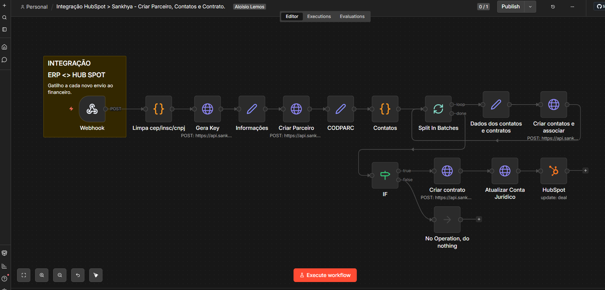

# Cadastro integrado — HubSpot → ERP Sankhya

Desenvolvi esta integração com **n8n, webhook e APIs do HubSpot e ERP Sankhya** para automatizar a passagem de dados comerciais ao cadastro de parceiro, contatos e contrato no ERP.

## Desafio e impacto

Após a mudança de SAP para Sankhya, precisei reconstruir a integração para as entidades e o processo do novo ERP. Antes, o time copiava dados contratuais do CRM e preenchia um formulário extenso; na minha experiência, isso levava entre uma e duas horas, dependendo do cliente.

Organizei a rotina para criar os registros e devolver as referências ao CRM em poucos segundos no ambiente em que trabalhei. Esses tempos são observações da operação, sem medição independente nesta publicação.

Um dos desafios foi aprender a montar os serviços, entidades e payloads do ERP. Para implementar o cenário de contatos e associações que precisava, investiguei as chamadas feitas no navegador e adaptei as requisições da integração.

## Fluxo

```mermaid
flowchart LR
    A[Webhook: dados da conta] --> B[Normalizar documentos]
    B --> C[Autenticar no Sankhya]
    C --> D[Criar parceiro]
    D --> E[Obter CODPARC]
    E --> F[Separar contatos Financeiro e Legal]
    F --> G[Loop: criar e associar contatos]
    G --> H[Conferência e criação de contrato]
    H --> I[Atualizar referências da conta HubSpot]
    I --> J[Atualizar etapa do negócio]
```

Parceiro, contatos e contrato dependem de vínculos, especialmente **CODPARC**. Não é uma simples cópia de campos entre formulários.

## Screenshot

## Explore

- [Template inativo de 16 nós](workflows/workflow.template.json)
- [Normalização, contatos e vínculos](docs/dados-vinculos.md)
- [Desafio técnico e investigação das rotas](docs/desafio-api.md)
- [Inventário e código](docs/inventario.md)
- [Configuração](docs/configuracao.md)
- [Preparação pública](docs/publicacao.md)
- [Validação](docs/validacao.md)
- [Projeto complementar: visão financeira no CRM](https://github.com/alosiolemos/n8n-sankhya-hubspot-financial-sync)

Template sem credenciais, IDs privados ou dados de clientes; integrações desabilitadas. Não houve criação de parceiros, contatos ou contratos nesta preparação.
